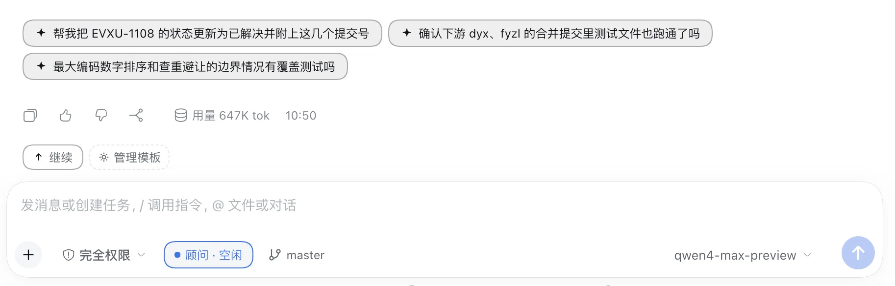

# Suggestions & reply templates

English | [中文](README.zh.md)

A [DeepSeek Harness](https://www.npmjs.com/package/@deepseek-ai/dsh) plugin that adds two conversation surfaces:

1. **Follow-up capsules** — 1–3 clickable follow-up messages below each completed answer, generated from the answer text and phrased in your voice. Click one to send it as an ordinary message.
2. **Message templates** — a chip row above the composer for reusable phrases and frequent commands. Each template is configurable as *fill the input box* or *send directly* on click.



## Follow-up capsules

After a turn completes, the plugin makes one auxiliary model request that reads the turn's user prompt and answer, then returns 1–3 short suggestions anchored to what the answer actually said (a concrete next step, clarification, extension, or verification). They render as brand-tinted pills below the answer.

- **Click to send**: a capsule goes through the composer's normal submission path — idle sessions send immediately; busy sessions use your configured Queue/Steer delivery.
- **Latest turn only**: capsules show for the latest completed turn while the session is idle, and disappear when a new turn starts. Scrolling back shows no historical capsules.
- **Route**: the auxiliary request uses the session's current model by default; set `provider` and `model` together in the row config to pin a different route.
- **No log pollution**: suggestions are an in-memory cache per session/turn, never written to the session log. After a restart they regenerate on demand when the latest turn is viewed.
- **Skipped turns**: interrupted, errored, max-token, and subagent turns get no capsules. A failed or timed-out auxiliary request simply shows nothing.

## Message templates

The chip row above the composer lists your saved templates, aligned with the conversation column.

- **Per-template click behavior** (`sendMode`):
  - `fill` (default) — click inserts the text into the input box for manual editing and sending.
  - `send` — click sends the text immediately as an ordinary message. Send-mode chips carry an ↑ arrow and a tinted border.
- **Manage templates** popover: add, edit, reorder (↑/↓), and delete. Each row shows a 填入/发送 (Fill/Send) badge; the edit form has a segmented *On click* control.
- **Global hotkeys**: optionally record a combo (e.g. `Ctrl+Shift+1`) in the form's
  shortcut field; pressing it sends the template app-wide, even while typing in the
  composer. Combos register through DSH's shortcut registry — conflicts with existing
  commands are rejected while recording, and the binding appears in the shortcut
  reference. The chip shows the combo as a keycap. Hotkeys require Ctrl, Alt, or Meta.
- **Live sync**: templates live in the Host's `suggestions_reply` storage domain (`$DSH_HOME/storages/suggestions_reply.json`), not in browser storage. Every page connected to the same Host — desktop window, browser tabs, remote Web UI — shares them and updates live over SSE; window focus also triggers a catch-up refresh. A separately launched Host process keeps its own state.
- **Durable**: templates survive restarts and plugin upgrades. Existing templates without `sendMode` migrate to `fill` automatically.
- **Starter set**: a fresh install seeds three send-mode templates — 继续 (`Alt+3`),
  推送 (`Alt+2`), 修复 (`Alt+1`) — once; deleting them never re-creates them.
- **Limits**: 50 templates by default (`maxTemplates`), title 1–60 chars, text 1–4000 chars.

### Agent tool

The agent manages the same templates through `message_templates` (same Host operations as the UI):

| Action | Arguments | Result |
|---|---|---|
| `list` | — | all templates with ids, ordered |
| `add` | `title`, `text`, optional `sendMode`, `hotkey` | the created template |
| `update` | `id`, optional `title` / `text` / `sendMode` / `hotkey` | the updated template |
| `remove` | `id` | `{ removed: true }` |

Call `list` before `update`/`remove` to read exact ids and current content. Failures return `{ ok: false, error }`.

## Installation

Requires DSH `>=0.2.1-rc.3 <0.3.0` and Node `>=22`.

### Via the plugin repository (recommended)

This plugin is listed in [Xia Ji's DSH plugin repository](https://dsh.gson.cn/), a shared
index that DSH's **Discover** page reads directly:

1. **Enable custom indexes**: open **Plugins**, find **Experimental plugins**, and turn on
   **Custom plugin indexes**.
2. **Add the index once**: switch to the **Discover** tab and add the index address
   `https://dsh.gson.cn/index.json`. This is a one-time setup shared by every plugin in the
   repository.
3. **Install**: locate **Suggestions & reply templates** (追问胶囊与消息模板) in Discover,
   confirm the shown DSH compatibility, and install. Updates arrive the same way.

### Direct install

- **Ask the agent**: in any DSH session, ask it to install the bundle `dsh-suggestions-reply`
  (it uses `plugin_manager` `install_bundle`).
- **Plugins UI**: **Plugins → Add plugin** with the npm package name `dsh-suggestions-reply`,
  or with the absolute path of a local checkout.

### After installation

The plugin activates immediately; both surfaces appear in every session. Tune it on the
plugin row's config page (see [Row config](#row-config)). Disable or remove it from
**Plugins** at any time — stored templates are kept.

## About the plugin repository (dsh.gson.cn)

[https://dsh.gson.cn/](https://dsh.gson.cn/) is a plugin showcase and index maintained by
夏悸 together with community developers:

- **One index, many plugins**: the site serves `index.json` (format 1) listing nine plugins —
  advisors, notify, deployment panel, Yunxiao board, whale break, this plugin, and community
  entries. DSH Discover browses and installs from it; each plugin installs independently.
- **Compatibility first**: every version declares its `engines.dsh` / `engines.node` range,
  and Discover shows whether it fits your running DSH before you install.
- **Open source**: each entry links to its public repository and npm package; versions and
  publish times come from npm, so what you install is what the author published.
- **This plugin's entry**: category *AI assistant*, icon and screenshots served from the
  site, install source npm `dsh-suggestions-reply`.

The index address to add in Discover is always `https://dsh.gson.cn/index.json`.

## Row config

Edit the plugin row's config on its **Plugins** page, or override it in the profile's `cordis.patch.yml`:

| Field | Default | Meaning |
|---|---|---|
| `enabled` | `true` | Generate and show follow-up capsules. |
| `maxSuggestions` | `3` | Capsule count per turn (1–3). |
| `provider` / `model` | empty | Auxiliary route; empty follows the session's current model. Set both together. |
| `maxOutputTokens` | `300` | Output token cap of the auxiliary request. |
| `timeoutMs` | `20000` | Auxiliary request deadline (ms). |
| `maxInputChars` | `6000` | Answer-text budget fed to the auxiliary request (tail kept). |
| `templatesEnabled` | `true` | Template row, manager popover, and agent tool. |
| `maxTemplates` | `50` | Template count cap. |

## Data & privacy

- The auxiliary request sends the turn's first user prompt (≤2000 chars) and the answer's final text (≤`maxInputChars`) to the session's model provider — or the route you pin. It is tagged with purpose `suggestions-reply` and is not recorded in the session log.
- Templates are stored locally under `$DSH_HOME/storages/`. Nothing else leaves your machine.
- Turning the plugin off removes both surfaces and the tool; template data is retained.

## Limitations

- Capsule quality depends on the auxiliary model; generic answers yield generic suggestions.
- One auxiliary request per completed turn adds a small token cost (capped by `maxOutputTokens`).
- Cross-process live sync (two separate Host processes) is not provided; share one Host's Web URL instead.

## Development

```text
index.js          Host half: projection, generation, storage domain, RPC + SSE routes, agent tool
client.js         Client half: capsule row, template dock, manager popover
cordis.patch.yml  Bundle patch (one plugin row)
locale/           Plugin Manager display metadata (en, zh)
icon.svg          Plugin icon
docs/             README screenshot
```

```bash
node --check index.js && node --check client.js   # syntax
npm pack --dry-run                                 # verify the packed file list
```

## License

[MIT](LICENSE)